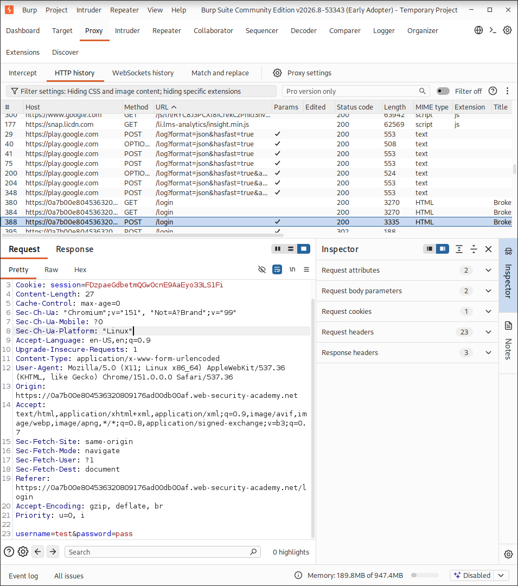
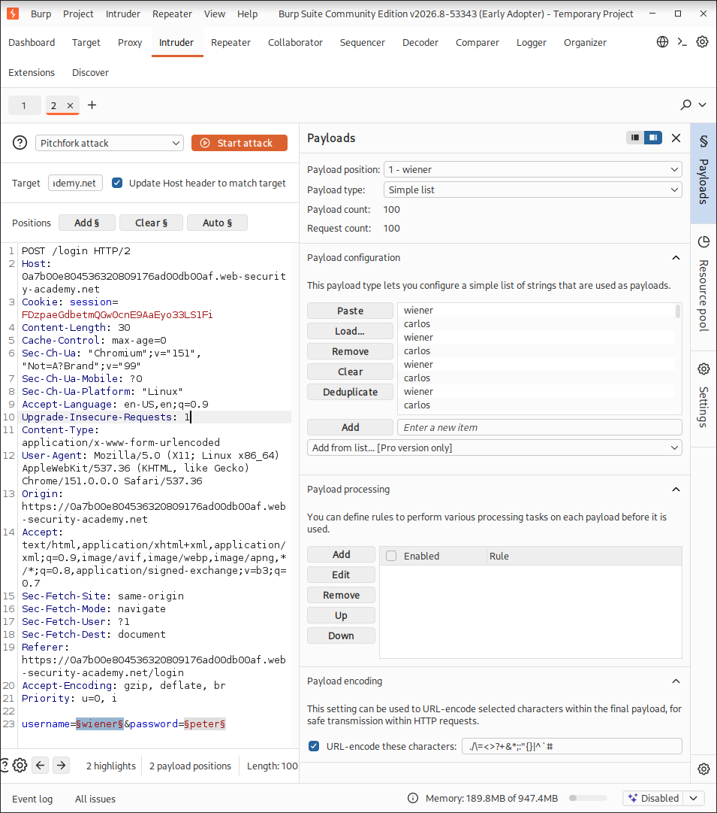
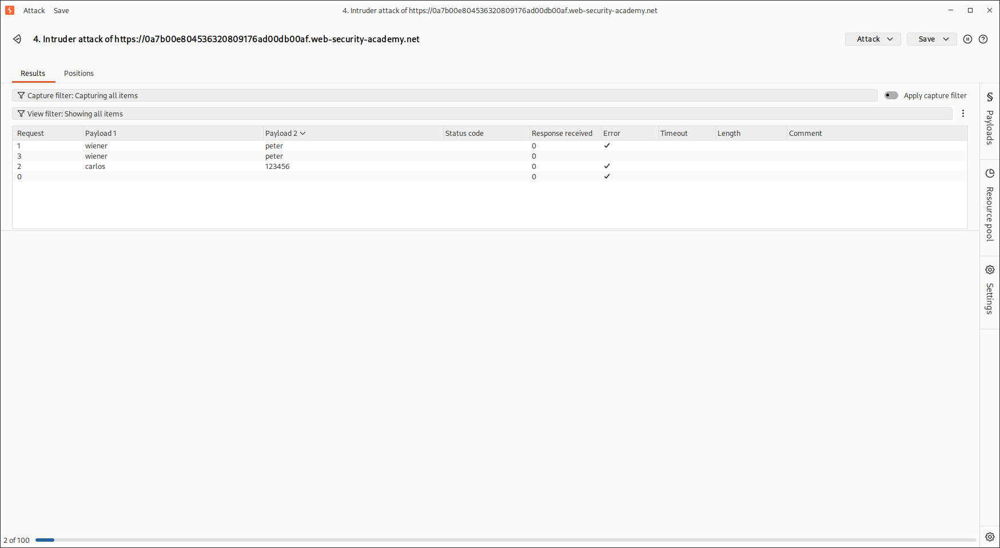
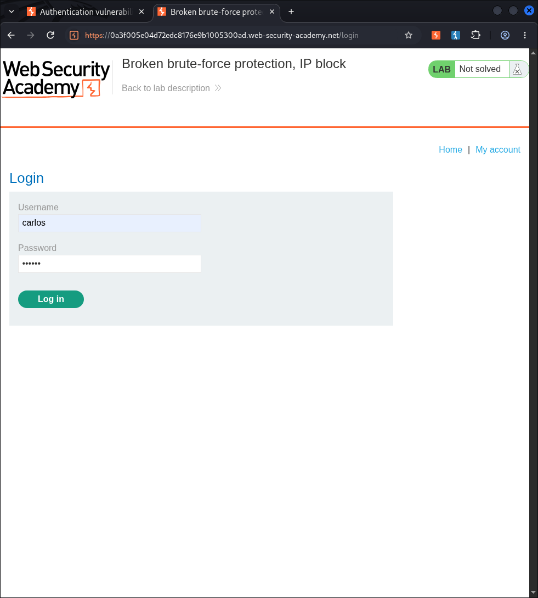
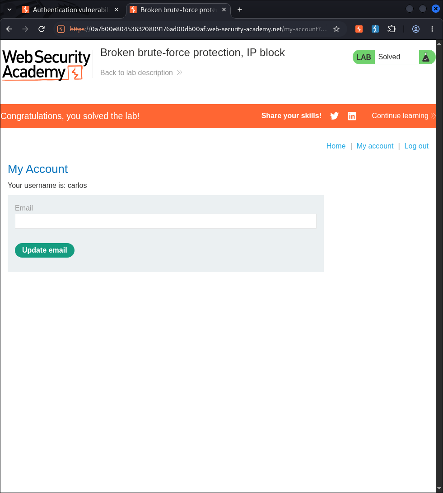

# Broken Brute-Force Protection, IP Block

## Overview
This repository documents the step-by-step walkthrough for solving PortSwigger Web Security Academy's lab on **Broken brute-force protection, IP block**.

The vulnerability arises because the rate-limiting mechanism resets the counter for consecutive failed login attempts whenever a valid login occurs before reaching the blocking threshold. By alternating brute-force guesses against the victim's account (`carlos`) with valid logins to our own account (`wiener`), we can bypass the IP-based blocking mechanism and determine the victim's password.

---

## Step-by-Step Solution

### Step 1: Initial Reconnaissance & Intercepting Requests
Attempting multiple incorrect logins triggers a temporary IP block. However, logging into a valid account resets the failed attempt counter.

1. Submit an initial login attempt in the web browser.
2. In **Burp Suite Proxy -> HTTP history**, locate the `POST /login` request.

---

### Step 2: Configure Burp Intruder Attack
1. Send the `POST /login` request to **Burp Intruder**.
2. Change the **Attack type** to **Pitchfork**.
3. Set the payload positions on both the `username` and `password` parameters:
   * `username=§wiener§`
   * `password=§peter§`

---

### Step 3: Configure Payload Lists
Go to the **Payloads** side panel:

* **Payload Position 1 (Username):**
  * Set **Payload type** to **Simple list**.
  * Add a list of usernames that alternates between your valid username (`wiener`) and the target username (`carlos`). Ensure `wiener` is first and `carlos` is repeated at least 100 times.

* **Payload Position 2 (Password):**
  * Set **Payload type** to **Simple list**.
  * Add your valid password (`peter`) before each candidate password for `carlos`, matching the alternating structure of Position 1.

---

### Step 4: Execute the Attack & Identify the Password
1. Click **Start attack**.
2. Once complete, filter or sort the results to identify successful responses.
3. Locate the request for `carlos` returning a **302 Redirect** status code (or different response length), indicating a successful login attempt.
4. Note the corresponding password from the **Payload 2** column.

---

### Step 5: Log In and Solve the Lab
1. Return to the lab login page in your browser.
2. Enter the target username `carlos` along with the identified password.

3. Access Carlos's account page to successfully complete the lab.

